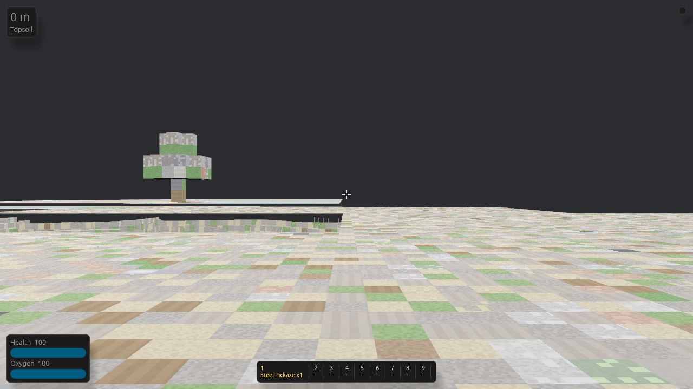

# Deepcore

A co-op, first-person voxel mining game in Rust. Players spawn at a surface camp above a huge
procedurally generated mine, start with a steel pickaxe, and dig their way down through six layers
and six Eras until they can refine uranium and build a **Nuclear Drill**.

Built on Bevy 0.20 with a headless authoritative server, renet/UDP networking via
`bevy_replicon`, and all content in editable RON files.



*An unmodified screenshot of a client connected to a dedicated server: terrain generated from the
seed, a tree, the depth meter, vitals and the starting Steel Pickaxe in hotbar slot 1.*

## Quick start

```bash
# 1. Build
cargo build --release

# 2. Run a server (headless, no GPU needed)
cargo run -p deepcore_server -- --bind 0.0.0.0:5000 --seed 12345

# 3. Run a client and join it
cargo run -p deepcore_client -- --connect 127.0.0.1:5000 --name Miner
```

The game generates its own textures at runtime from `assets/data/blocks.ron` — there is nothing to
download.

## Controls

| Key | Action |
|---|---|
| WASD | Move |
| Space | Jump / swim up |
| Shift | Sprint |
| Ctrl | Crouch |
| Left mouse | Mine |
| Right mouse | Interact with a block or machine |
| 1–9 | Select hotbar slot |
| E | Inventory |
| T | Tech tree |
| N | Power network overlay |
| F3 | Debug overlay |
| Esc | Release / recapture the mouse |

## Command line

**Server**

```
--bind <ADDR>             UDP address to listen on (default 0.0.0.0:5000)
--content <DIR>           content directory (default assets/data)
--seed <N>                world seed
--bots <N>                headless bots for load testing
--simulate-latency <MS>   artificial latency applied to inbound intents
--simulate-loss <PCT>     artificial packet loss percentage
--save-dir <DIR>          where saves are written (default saves)
--max-ticks <N>           stop after N ticks (integration tests)
```

**Client**

```
--connect <ADDR>          join a server immediately
--name <NAME>             display name
--content <DIR>           content directory
--simulate-latency <MS>   artificial latency
--simulate-loss <PCT>     artificial packet loss
--view-distance <N>       render distance in chunks
```

## Lobby service (accounts and server browser)

```bash
cargo run -p deepcore_lobby -- --bind 0.0.0.0:8080 --database-url "sqlite:lobby.db?mode=rwc"
```

Endpoints: `POST /register`, `POST /login`, `GET /verify/{token}`, `GET /servers`,
`POST /servers/register`, `POST /servers/{id}/heartbeat`, `GET /health`.

## Adding content

Everything a designer changes lives in `assets/data/`:

| File | Contents |
|---|---|
| `blocks.ron` | every block: hardness, tool tier, drops, colour, pattern, emissive, radiation |
| `items.ron` | items, tools (tier/speed/area/energy), placeable blocks and machines, modules |
| `machines.ron` | machine footprint, energy, slots, build cost, role, cascade rules |
| `recipes.ron` | every recipe: machine, time, inputs, outputs, tech gate |
| `tech_tree.ron` | research nodes, parents, delivery costs, unlocks |
| `layers.ron` | the six depth layers: base block, filler, ores, hazards, ambient temperature |
| `hazards.ron` | per-layer hazard multipliers |
| `tuning.ron` | speeds, gravity, reach, oxygen, radiation thresholds, tick rate |

Adding an ore or a recipe never requires touching Rust. The loader validates everything at startup
and refuses to run with a clear message if:

* a recipe or build cost references an unknown item;
* a recipe names a machine that cannot process it;
* a tech node unlocks something that does not exist;
* the tech tree has a cycle;
* an ore drops an item that nothing consumes;
* a layer is missing a block or leaves a gap in the depth ranges.

Check your edits with:

```bash
cargo run -p deepcore_shared --bin balance_report   # raw ore needed per Era
cargo test -p deepcore_shared                        # content + logic tests
```

## Regenerating the texture atlas PNG

The client paints its atlas in memory at startup, but the same generator can write a PNG for
inspection:

```bash
cargo run -p atlas_gen -- assets/data assets/generated/atlas.png
```

## Architecture

```
crates/shared/   every rule of the game (content, voxels, worldgen, movement, inventory,
                 crafting, power, hazards, protocol). No sockets, no rendering.
crates/server/   headless authority: chunk store, generation workers, intent validation,
                 mining, machines, power, hazards, persistence.
crates/client/   windowed: chunk meshing on the async task pool, first-person input,
                 movement prediction, egui UI, HUD, procedural audio.
crates/lobby/    axum + sqlx accounts, tokens and the server browser.
tools/atlas_gen/ procedural texture atlas generator.
```

The server is the source of truth for everything except the local player's movement, which the
client predicts with the same code from `shared::movement` and reconciles against the server's
acknowledgements.

## Testing

```bash
scripts/check.sh        # fmt + clippy -D warnings + all tests
cargo test --workspace
```

`scripts/smoke_test.sh` runs a real server and a real client headless (Xvfb) and reports both logs.

## Layout of a session

1. **Era 0** — chop trees, build a workbench, craft a kiln, find coal and copper in the Shale Beds.
2. **Era 1** — smelt ingots, build an anvil and a blast furnace, forge the Hardened Steel Pickaxe.
3. **Era 2** — boilers, pipes, engines, crushers and washers; the Steam Drill opens the Basalt Furnace.
4. **Era 3** — turbines, generators, cables, batteries; brownouts scale every consumer.
5. **Era 4** — chemistry, stainless steel, tungsten carbide; the Tungsten-Carbide Drill reaches the
   Deep Crust where uranium lives.
6. **Era 5** — leach, precipitate, convert, enrich, fabricate; run the reactor and bore a 3×3 tunnel
   into the Mantle Edge with the Nuclear Drill.

## Known limitations

See `PROGRESS.md` for the current milestone status and every deferred item.
